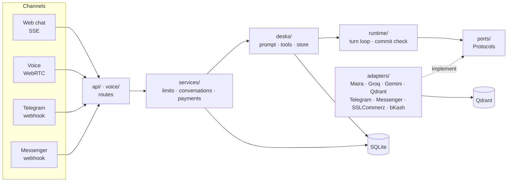

# HeyDesk

An AI front desk an online shop can set up in minutes. It fills in its products, delivery
areas and FAQ, and adds its own notes. Customers talk to the agent by web chat, on Telegram,
Facebook Messenger or WhatsApp. It answers questions, takes orders and messages, and hands over
to a person when needed.

**The model talks; code guarantees.** The model writes the words. Python decides every price,
total, date and stock count, and nothing is saved until the agent has read it back and heard a
clear yes, checked by a separate model that fails closed.

## Status

Built and tested: the shop desk, web chat, voice (off for now), Telegram,
Messenger, WhatsApp, photo search in the shop, coupons and offers to recent chats, online payments, a Google Sheet as a product list, the
owner's API and the admin panel. The shop passed a live run on a real model. What's next is in
**[PLAN.md](PLAN.md)**. The owner's and admin's screens are a separate Vue app,
`../heydesk-frontend`.

## How it works



- **One turn:** the visitor's message passes the limits, then the system prompt is built
  from the business's current config. The model may call the desk's tools. A tool checks facts
  in Python, and a writing tool only saves after a read-back and a yes. Every turn is saved with
  its tokens, time and cost (never the customer's words) for the admin.
- **Desks:** each kind of business is one folder in `src/heydesk/desks/` with its own prompt,
  tools, tables and routes. A new kind is a new folder.
- **Layers:** imports point inwards (routes → services → desks → runtime → ports). `runtime/`
  knows no framework, database or SDK; only `wiring.py` picks the adapters.
  `scripts/check_imports.sh` enforces this in CI.

The details are in [docs/design.md](docs/design.md), and the reason for each choice in
[docs/decisions.md](docs/decisions.md).

## Tech stack

| | |
|---|---|
| Backend | Python 3.12, FastAPI (async), pydantic v2 |
| Data | SQLAlchemy 2.0 (async) and Alembic on SQLite; Qdrant for documents and photos |
| Talking | Gigalogy's Maira (default) or Groq (`openai/gpt-oss-120b`), behind one `LanguageModel` port |
| Knowledge and photos | Gemini embeddings, hybrid (meaning + exact word) search in Qdrant |
| Voice | Pipecat over WebRTC, Silero VAD; Deepgram, Chorus or our Whisper to hear; a Bangla voice (our TTS server) or Piper to speak |
| Channels and payments | Telegram Bot API, Messenger (Graph API), SSLCommerz, bKash |
| Tooling | uv, pytest, ruff, mypy (strict on the core), Docker, GitHub Actions (checks, a dependency audit, the image) |

## Security

- **Logins:** passwords are hashed with argon2. Login tokens are signed (JWT) and expire after
  7 days. In production the server refuses to start with an empty `JWT_SECRET` or a fake provider.
- **Tenants:** every table and query carries `workspace_id`, and tests check that one business
  can't see another's data.
- **Admins:** admins are made only from the command line, and the database confirms the role on
  every request. Owners get a 404 on admin routes. Every admin change goes to an insert-only
  audit log.
- **Abuse:** login allows 10 tries in 15 minutes per address and email, and signup 5 an hour per
  address. Chat allows 6 messages a minute per visitor and 60 per IP. Each visitor and each business has a daily cap, and a visitor
  who keeps going off-topic is blocked.
- **Webhooks and payments:** Telegram posts must carry the bot's own random secret, and
  Messenger posts must carry Facebook's HMAC signature. A payment counts only after the gateway's
  own API confirms it.
- **The model:** nothing is saved without a read-back and a yes: the model judges the yes, and
  Python saves only the details the visitor heard read back. Passages from documents are given to the model as facts, never as instructions.
- **Data:**
  - Logs hold ids only, never message text, names or phone numbers.
  - Uploads are capped at 10 MB.
  - The bot tokens and store passwords businesses give us are encrypted in the database
    (Fernet, with `SECRETS_KEY`), and no route returns them.
  - Our own keys live in `.env`, which is git-ignored.
- **Known limit:** a login token lasts 7 days, and changing the password doesn't end the ones
  already made (design §12).

## Running it

You need [uv](https://docs.astral.sh/uv/). Python 3.12 is installed by uv.

```bash
cp .env.example .env
uv sync
uv run alembic upgrade head
uv run uvicorn heydesk.main:app --reload
```

Open <http://localhost:8000> to chat with the dev agent, or press **Call** to talk to it
(Chrome allows the microphone on `localhost`).

Or let `scripts/dev.sh` do it. On its own it shows a menu: the backend, the backend with the
frontend (`../heydesk-frontend`), a public link, stop, status, logs and tests.
`scripts/dev.sh help` lists the short forms, such as `scripts/dev.sh a --fake --desk shop`.

In `.env`, pick the providers:

- **Talking:** `LLM_PROVIDER=gigalogy` with the three `GIGALOGY_*` keys (see
  [docs/gigalogy.md](docs/gigalogy.md)), or `LLM_PROVIDER=groq` with `GROQ_API_KEY`. `fake` runs
  without keys but only says canned lines.
- **Documents and photos:** `GEMINI_API_KEY` for embeddings, and Qdrant for search. Set
  `QDRANT_URL` and `QDRANT_API_KEY` from a Qdrant Cloud cluster, or leave the URL empty to use a
  local folder. `EMBEDDER=fake` runs offline but only matches words.
- **Voice:** `VOICE_LANGUAGE=bn` (the default) hears and speaks Bangla on every call, so the
  Bangla voice must be running: `uv run --directory tts_server uvicorn server:app --port 8010`,
  or `tts_server/kaggle_tts.ipynb` on Kaggle with its URL in `BANGLA_TTS_URL`. `en` speaks with
  Piper, which runs locally. To hear: Deepgram (`DEEPGRAM_API_KEY`), `STT_PROVIDER=chorus` for
  Gigalogy's Chorus, or `STT_PROVIDER=whisper` for our Bangla–English Whisper
  (`tts_server/kaggle_stt.ipynb` on Kaggle, its URL in `WHISPER_STT_URL`).

### With Docker

```bash
docker compose up --build
```

This runs the backend and Qdrant, and the dev page is at <http://localhost:8000>. The database
and photos live in a Docker volume, and migrations run when the container starts. Settings come
from `.env` if you have one. Without one, the fake providers run offline. For production, set
`APP_ENV=production` with real providers, `JWT_SECRET` and `SECRETS_KEY`: the server refuses to
start without them.

### Deploying to Render

Production is Render, set up from `render.yaml`. Only CI deploys: a PR merged into `main` goes live
after every check passes. To set it up once:

1. Make a free cluster on [Qdrant Cloud](https://cloud.qdrant.io): its URL and API key.
2. Render > **New > Blueprint** > this repo. It makes `heydesk-api` and the `heydesk-db` Postgres.
   Fill in the values it asks for (API keys, `PUBLIC_URL`, `CORS_ORIGINS`, R2, Qdrant).
3. Render > `heydesk-api` > **Settings > Deploy Hook**: copy it into GitHub > Settings > Secrets
   and variables > Actions as the secret `RENDER_DEPLOY_HOOK`. Add the variable `RENDER_URL`
   (`https://….onrender.com`).
4. GitHub > Settings > Branches: protect `main`, require a pull request and the `check`,
   `postgres`, `audit` and `image` jobs.

A bad deploy is undone with Render's **Rollback**. The frontend deploys to Vercel from its own repo.

## Tests and checks

```bash
scripts/check.sh   # tests, lint, format, types, import rules: what CI runs
```

The tests are offline and free: fake models, an in-memory database and Qdrant's in-memory mode.
`uv run pytest -m live` calls the real providers and costs quota.

## Switching the seed

The dev agent is the shop desk and a seed file. For the Banglish shop, set these in `.env` and
restart:

```bash
DEV_AGENT_KIND=shop
DEV_AGENT_SEED=examples/agents/shop-bn.yaml
```

Edit the seed (`examples/agents/*.yaml`) and restart to change the dev agent. Any agent can be
opened on the dev page with `http://localhost:8000/?key=<public_key>`.

## Using the API

Swagger is at <http://localhost:8000/docs>. Everything that belongs to a business needs a login
token:

```bash
uv run heydesk create-user you@example.com "a long password"   # an owner of the dev business
uv run heydesk create-admin you@example.com "a long password"  # a platform admin (no business)
```

Each prints a token. In Swagger, press **Authorize** and paste it. Forgot a password?
`uv run heydesk reset-password you@example.com` prints a new one, and
`scripts/dev.sh admin` manages admins from a menu.

| | |
|---|---|
| `POST /api/auth/signup` | A new business and its owner; it never sees another business's data |
| `GET /api/desks` | The kinds of business, and the fields each one's agent has |
| `POST /api/agent` | Create your agent: `{"kind": "shop"}` is enough. `GET /api/agent` then lists what is `missing` |
| `PATCH /api/agent` | Edit it: `{"faq": "…"}`, or `{"notes": "Be formal."}` for tone and rules. Live on the next message |
| `POST /api/agent/documents` | Add text, or a `.txt`, `.md` or `.pdf` (`/file`), to the agent's knowledge |
| `GET/PUT /api/products` | The products, replaced whole; also takes a CSV at `…/import` |
| `GET /api/shop/orders` · `/api/messages` | What the agent took, newest first. `PATCH …/{id}` with `{"status": …}` moves one along its flow |
| `GET /api/conversations/{id}` | What was said |
| `PUT /api/agent/telegram` · `/api/agent/messenger` | Put the agent on Telegram or Messenger (needs `PUBLIC_URL`) |
| `GET /api/admin/…` | Admins only: businesses, the overview, failed turns. Act inside a business with an `X-Business: <id>` header |

Errors always look like `{"error": {"code": "…", "message": "…"}}`, with `fields` when a field is
wrong.

## Telegram

1. In Telegram, message [@BotFather](https://t.me/BotFather), send `/newbot`, and copy the token.
2. Put your ngrok domain in `.env` as `PUBLIC_URL=https://….ngrok-free.app`, and start
   everything with `scripts/dev.sh public`.
3. In the frontend, open **Your agent** → **Where customers reach you** → **Set up Telegram**,
   and paste BotFather's reply (or `PUT /api/agent/telegram` with `{"token": "…"}`).
4. Open the `link` it returns and press **Start**.

## Voice latency

The time from the caller's last word to the agent's first sound. Keep the server's log, make
about ten calls, then run the report:

```bash
uv run uvicorn heydesk.main:app 2>&1 | tee voice.log
uv run python scripts/latency.py voice.log
```
